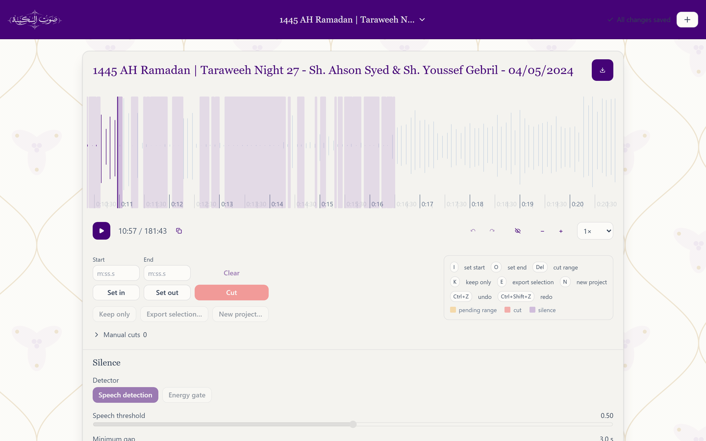
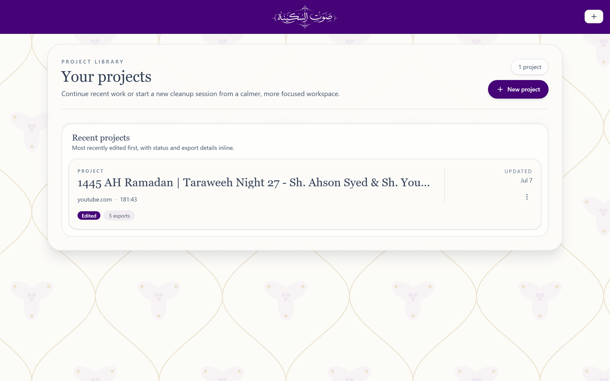
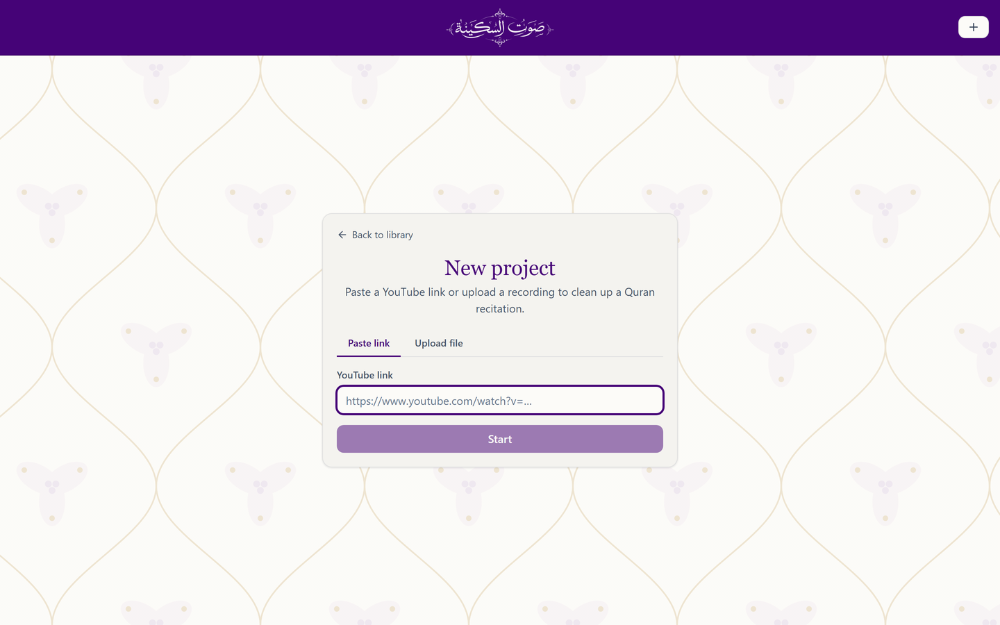
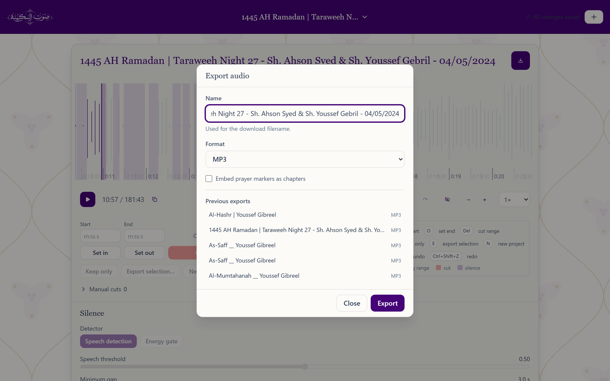

<p align="center">
  
</p>

<p align="center">
  A non-destructive editor for salah and Quran recitation recordings.<br>
  Paste a YouTube link or drop in a file, find the silences and the takbirs, cut what you do not need, export.
</p>

<p align="center">
  
</p>

## What it does

- **Acquires** audio from a YouTube URL or an uploaded file and keeps a 16 kHz working copy per project.
- **Detects silence** with Silero voice-activity detection, so quiet dhikr and room noise are treated as non-speech rather than as recitation. An ffmpeg energy gate remains available as a fallback.
- **Detects prayer phrases** (takbir, tasmi', tahmid, tasleem) with Whisper and turns them into timeline markers, then derives the rak'ah and position outline from the marker stream.
- **Edits non-destructively.** Cuts, keeps and markers live in an edit decision list. The waveform collapses cut audio out of view, and nothing is rendered until you export.
- **Exports** the edited result, or a selected range, with chapter markers embedded. A range can also be split off into its own project.

Detection returns data; only export writes audio. That rule shapes every module in the repo.

## Quickstart

Prerequisites: Python 3.10+, [FFmpeg](https://ffmpeg.org/) (ffmpeg and ffprobe on `PATH`), [Node.js](https://nodejs.org/), and GNU make (on Windows: `choco install make`, or use Git Bash or WSL).

```sh
make requirements   # pip install -e ".[service,phrases,vad,desktop]"
make dev            # backend http://127.0.0.1:38427 + frontend http://localhost:38428, hot reload
make desktop        # build the frontend and open the app in a native window
```

`make help` lists every target. The Whisper model downloads on first phrase detection (about 3 GB for `large-v3`).

One-shot extraction with silence removal, no server:

```sh
python -m sawt_sakinah extract "https://www.youtube.com/watch?v=..."
```

## How it works

```
 YouTube / file ──> extraction ──> mp3 + working copy + speech map ──┐
                                                                    │
            ┌────────────── detection (read-only) ──────────────────┘
            │  silence:  speech map ──> spans ──> gaps >= 3 s
            │  phrases:  speech clips ──> Whisper ──> fuzzy match ──> markers
            │  prayer:   markers ──> positions / rak'ahs
            ▼
      edit decision list  (cut / keep / marker, built in the UI)
            │
            ▼
        editing (ffmpeg render) ──> exported audio + chapters
```

The speech map is a per-frame speech-probability track computed once when a source is
acquired. Every later silence re-detect is a numpy threshold over that track, so the
speech-threshold slider responds instantly, and phrase detection transcribes only the
speech it describes.

## Configuration

Every tuning knob lives in one strictly validated file, `sawt_sakinah/config/defaults.yaml`
(silence thresholds, VAD sensitivity, Whisper model, export format). Point
`SAWT_CONFIG_FILE` at a copy to override the whole set. Operational settings such as
storage directories, worker counts and the ffmpeg path accept `SAWT_*` environment
variables or a `.env` file.

## Repository layout

```
sawt_sakinah/
  config/       defaults.yaml + strict schema (the single source of tuning knobs)
  models/       pydantic contracts shared by every layer
  extraction/   YouTube download, file import, working copy, speech map, cache
  detection/    silence (VAD / ffmpeg), phrases (Whisper), Silero ONNX asset
  prayer/       prayer-position state machine over the marker stream
  editing/      EDL render and export (the only layer that writes audio)
  service/      FastAPI app, job pools, project store, routes
frontend/       React 18 + TypeScript + Vite + Tailwind + TanStack Query, wavesurfer.js
docs/           architecture (audio/, frontend/), design records (plans/), screenshots
scripts/dev.py  runs backend and frontend together
```

## Screens

| Library | New project | Export |
|---|---|---|
|  |  |  |

## Documentation

Start at [docs/README.md](docs/README.md) for the architecture map, then the audio-engine
and frontend documents it links. Design records for larger changes are kept in
[docs/plans/](docs/plans/).
