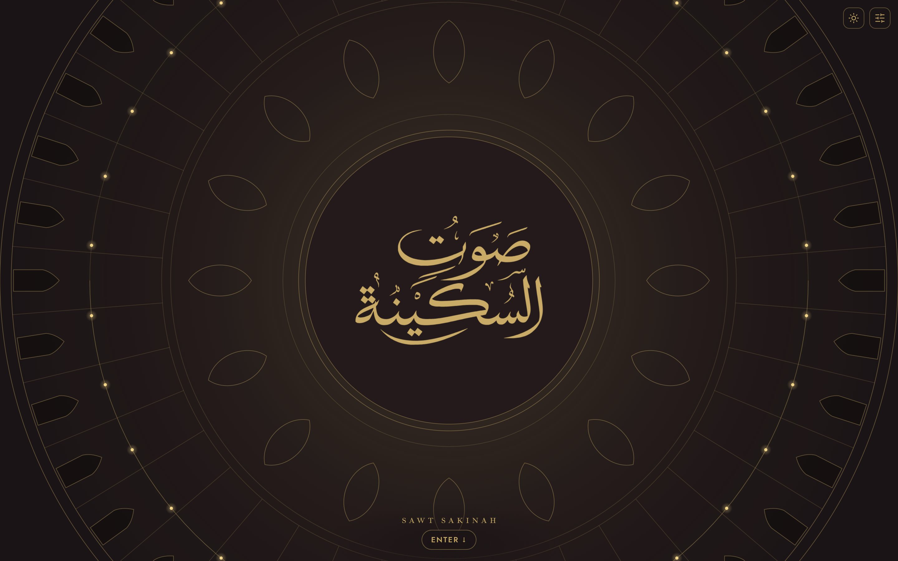
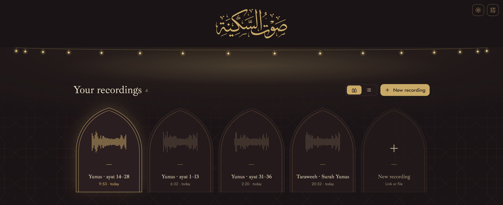
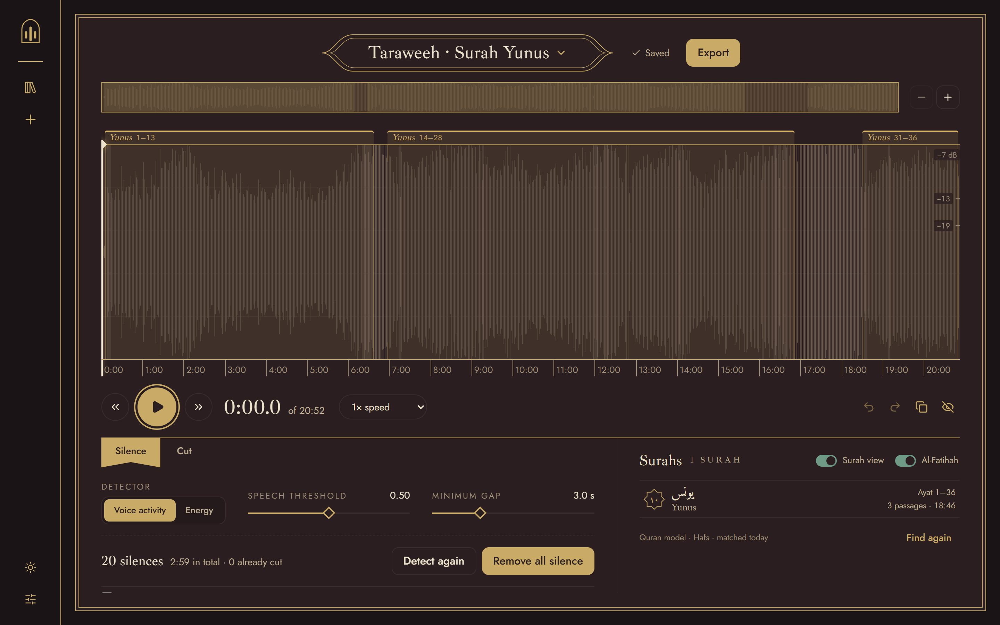
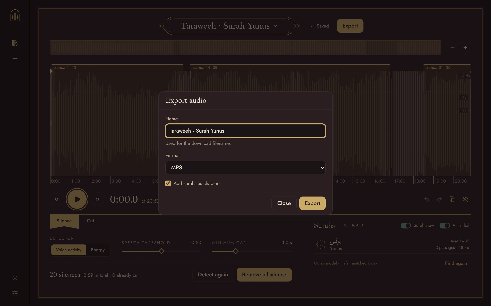
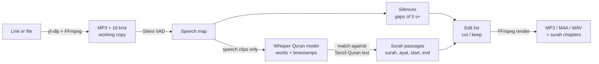

<p align="center">
  <picture>
    <source media="(prefers-color-scheme: dark)" srcset="docs/assets/logo-horizontal-gold.svg">
    
  </picture>
</p>

<p align="center">
  Save the recitations you love, and nothing else.<br>
  Paste a link or drop in a recording, find the surahs, trim the rest, export.
</p>

<p align="center">
  
</p>

## Why this exists

This started with a small problem I kept running into. I'd hear a beautiful recitation,
on YouTube or in person at taraweeh or a qiyam, and I'd want to keep it and listen to it
on repeat. Lots of masjids livestream, so the recording is usually out there somewhere.
But getting just the audio out of it meant YouTube Premium, some editing software, and a
lot of time I didn't have.

So instead, I over-engineered an audio editor for exactly this one problem.

## What it does

- **Grabs the audio** from a link to a single video or post on YouTube, Instagram, X or
  Facebook, or from a file you already have (mp3, m4a, wav, flac, opus, or an mp4/mov video).
- **Finds the silences**: the ruku', the sujood, the long pauses. It tells real
  recitation apart from quiet dhikr and room noise.
- **Finds the surahs.** It transcribes the recitation, matches it against the Quran text
  and marks which surah and ayat are recited where, right on the waveform.
- **Lets you edit without wrecking anything.** Cuts are just a list of decisions until
  you export. Keep a single surah, remove all the silence in one click, or copy a surah
  out into its own recording.
- **Exports** MP3, M4A or WAV, with each surah added as a chapter.

Everything runs on your own computer. No account, no telemetry, and your recordings stay on your machine.

## A look around

The whole app is themed after the inside of a masjid at night. Dark mode is the
**Night** theme (there's a vellum-and-oxblood **Day** theme too).

You land under a **dome**: the name in gold calligraphy at the centre of a rosette, with
a ring of lamps around it (the screenshot at the top). Hit **Enter**, or just scroll, and
the dome lowers into the header. The lamps become a **chandelier** strung across the top
of the library, lighting the wall below.

**Library.** Each recording sits in its own mihrab-shaped niche on a star-lattice wall.
There's a list view too if you have a lot of them.

<p align="center">
  
</p>

**Editor.** The waveform with the recognised surahs marked across the top, silence
controls on the left, and the surah list on the right.

<p align="center">
  
</p>

**Export.** Pick a name and a format, and add the surahs as chapters.

<p align="center">
  
</p>

## Download and run

Grab the zip for your system from the
[latest release](https://github.com/H-Khan26/sawt-sakinah/releases/latest).

The app isn't code-signed (that costs money every year and this is a hobby project), so
Windows and macOS will both be suspicious of it the first time. Here's how to get past
that.

### Windows (10 or 11, 64-bit)

1. Download `SawtSakinah-<version>-windows-x64.zip`. If your browser warns that the
   file "isn't commonly downloaded", choose **Keep** (in Edge: **...** > **Keep** >
   **Show more** > **Keep anyway**).
2. Unzip it anywhere, for example `Documents\SawtSakinah`, and run `SawtSakinah.exe`
   from inside the unzipped folder.
3. Windows SmartScreen shows **"Windows protected your PC"**. Click **More info**, then
   **Run anyway**. You only have to do this once.

If the window stays blank, install the
[WebView2 Runtime](https://developer.microsoft.com/microsoft-edge/webview2/). Windows 10
and 11 usually have it already.

### macOS (Apple Silicon, macOS 14 or newer)

1. Download `SawtSakinah-<version>-macos-arm64.zip`, open it, and drag
   `SawtSakinah.app` into **Applications**.
2. Open the app. macOS says it can't verify the developer. Click **Done** (or **OK**).
3. Go to **System Settings** > **Privacy & Security**, scroll down to **Security**, and
   click **Open Anyway** next to the message about SawtSakinah. Confirm with your
   password. From then on it opens normally.

No **Open Anyway** button? Clear the quarantine flag in Terminal, then open the app
again:

```sh
xattr -dr com.apple.quarantine /Applications/SawtSakinah.app
```

macOS may ask a couple more things the first time:

- **"SawtSakinah would like to access files in your Downloads folder"**: click **Allow**.
  That's where exports go by default.
- A **Keychain** prompt: this only comes up if you turn on sign-in cookies from a
  browser in the settings, so the app can read that browser's cookies. Click
  **Allow**, or don't use the cookies option.

Intel Macs aren't supported by the download, but they can run it from source (below).

### First run

The speech model used to find surahs isn't in the zip. The app downloads it (about
80 MB) the first time you click **Find surahs**, then keeps it. Recognition runs on the
CPU and takes a few minutes per hour of audio. Importing and trimming are quick.

Please only download recordings you're allowed to: check the terms of the site you import
from (for example [YouTube's Terms of Service](https://www.youtube.com/t/terms)) and the
wishes of whoever streamed or posted it.

## How it works



1. **Extract.** [yt-dlp](https://github.com/yt-dlp/yt-dlp) pulls the audio from a
   YouTube, Instagram, X or Facebook link (with [Deno](https://deno.com/) for YouTube's JS
   challenges; share links are followed to the post first), or you import a file.
   [FFmpeg](https://ffmpeg.org/) turns it into an MP3 plus a 16 kHz mono working copy
   for analysis.
2. **Map the speech.** [Silero VAD](https://github.com/snakers4/silero-vad) (ONNX) runs
   once and scores every frame for "is someone speaking". Silences are the gaps of 3
   seconds or more. Moving the threshold slider just re-reads that map, so it's instant.
   An FFmpeg volume gate is there as a fallback.
3. **Transcribe.** Only the speech gets transcribed. The clips are packed into one
   stream and run through
   [tarteel-ai/whisper-base-ar-quran](https://huggingface.co/tarteel-ai/whisper-base-ar-quran),
   a Whisper base model fine-tuned on Quran recitation. It runs on CPU through
   [faster-whisper](https://github.com/SYSTRAN/faster-whisper) /
   [CTranslate2](https://github.com/OpenNMT/CTranslate2), using an int8 conversion
   hosted at
   [hkhan0327/faster-whisper-base-ar-quran](https://huggingface.co/hkhan0327/faster-whisper-base-ar-quran)
   and pinned to a commit. The output is words with timestamps on the original timeline.
4. **Match.** Both the transcript and the [Tanzil](https://tanzil.net) Quran text
   (Simple Clean, Hafs) get stripped down to bare letters. Every three-word sequence
   from the transcript is looked up in the Quran. From each hit the matcher walks
   forward and back through the mushaf, word by word, with fuzzy matching
   ([RapidFuzz](https://github.com/rapidfuzz/RapidFuzz)) so a misheard word doesn't
   break the run. Takbirs, Amin and du'a don't match, so a passage ends there, and long
   pauses split a surah across rak'ahs. Passages are scored, marked **accept** or
   **unsure**, and their edges are snapped out into the pauses so a cut never clips a
   word.
5. **Edit and export.** Your cuts and keeps live in a non-destructive edit list.
   Nothing touches the audio until export, when FFmpeg renders the result and writes the
   accepted surahs in as chapters.

The deep dive (architecture, thresholds, data model) is in [docs/](docs/README.md).

## Run from source

You need Python 3.10+ and [FFmpeg](https://ffmpeg.org/) on `PATH`,
[Node.js](https://nodejs.org/), and GNU make. [Deno](https://deno.com/) on `PATH` is
recommended: without it YouTube imports may fail.

```sh
make requirements   # install the Python package and its extras
make desktop        # build the frontend and open the app in a window
make dev            # or: backend + frontend with hot reload
```

## License

[MIT](LICENSE). Bundled third-party pieces keep their own licenses: Silero VAD (MIT),
the Tanzil Quran text (CC BY 3.0, used verbatim), the Quran Whisper model (Apache-2.0),
the webfonts (SIL OFL), and FFmpeg. Each release ships a `THIRD_PARTY_LICENSES.txt` with
the full list. Security issues: see [SECURITY.md](SECURITY.md).
